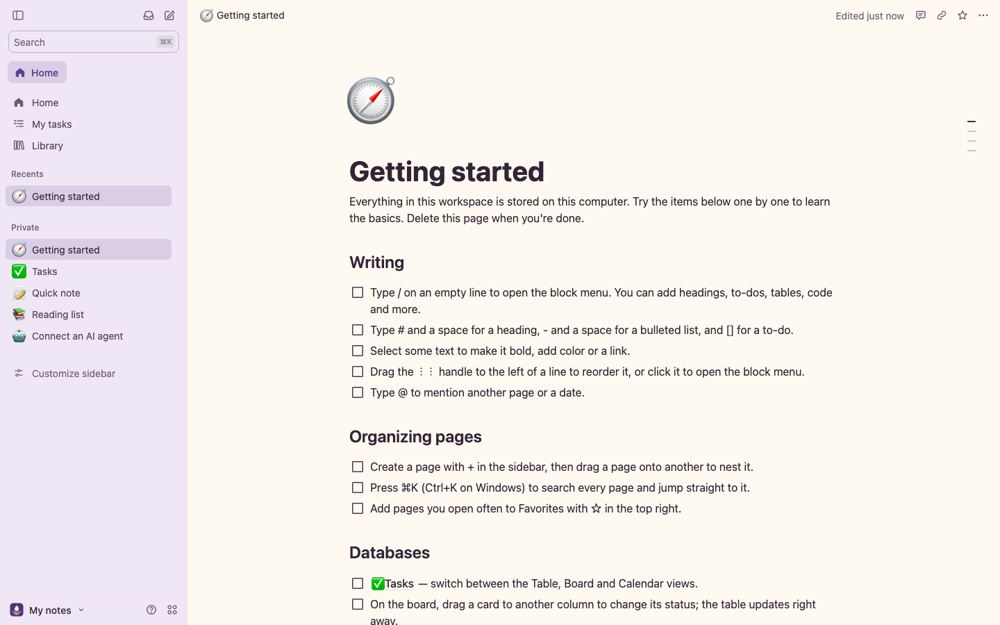
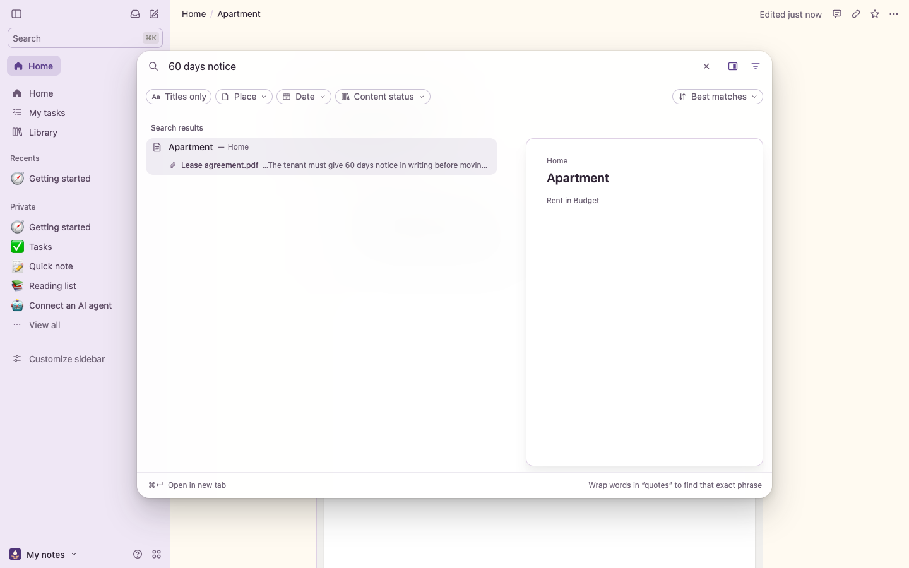
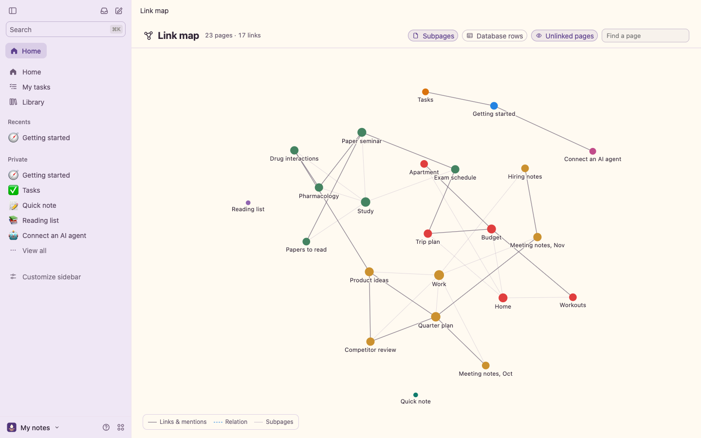
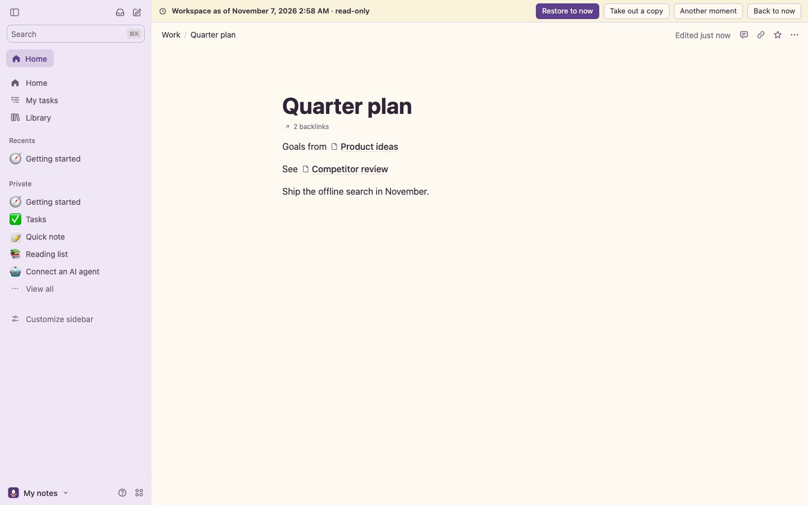
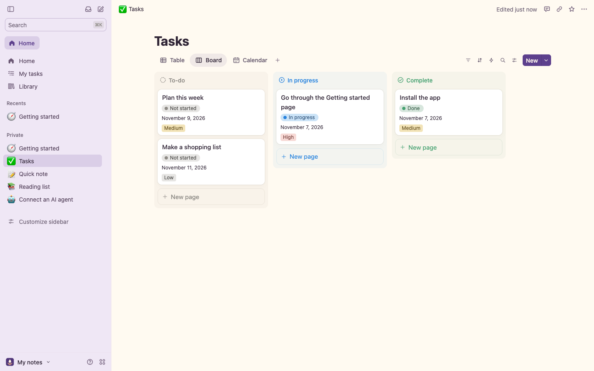
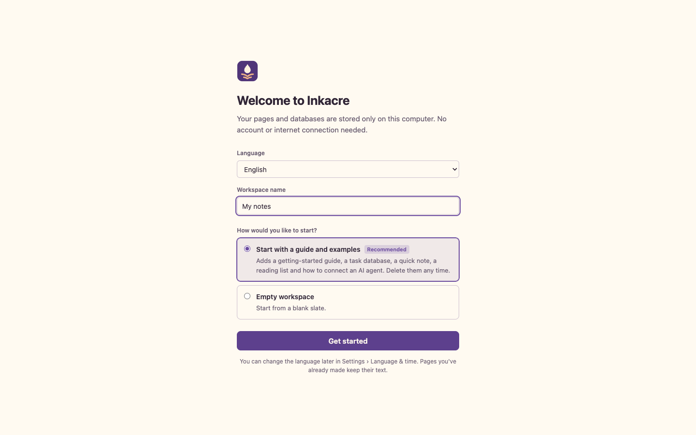

# Inkacre

**Páginas, bloques y bases de datos que viven en tu propio ordenador, y en las que tu agente de IA puede trabajar.**

[English](README.md) · [한국어](README.ko.md) · [日本語](README.ja.md) · [简体中文](README.zh-CN.md) · [繁體中文](README.zh-TW.md) · Español · [Français](README.fr.md) · [Deutsch](README.de.md) · [Português (Brasil)](README.pt-BR.md)



Inkacre es un espacio de trabajo local, para una sola persona, con el estilo conocido de bloques y bases de datos. Todo se guarda en un único
archivo SQLite en tu equipo: sin cuenta, sin nube y sin telemetría. La interfaz web, un servidor MCP integrado para
agentes de IA y el motor de comandos comparten ese archivo, así que un agente edita las mismas páginas que tú, y cada
cambio, tuyo o del agente, queda registrado y se puede deshacer.

## Lo que la mayoría de apps de notas no hace

- **Vuelve atrás en el tiempo** — abre todo el espacio de trabajo tal como estaba en cualquier momento anterior, de
  solo lectura y en su propia pestaña, y recupera una página o saca una copia.
- **Busca dentro de los archivos** — la búsqueda también encuentra palabras en archivos PDF, Word, Excel, PowerPoint,
  HWPX, OpenDocument y de texto adjuntos, y muestra el archivo y la línea.
- **Un mapa de enlaces** — cada página como un punto, con los enlaces, menciones y relaciones entre ellas; ábrelo
  alrededor de una página para ver lo que toca.
- **Captura desde cualquier sitio** — añade una línea, una tarea o una fila de base de datos desde Atajos, Raycast, un
  script o el terminal sin abrir la app; los archivos que dejes en una carpeta de entrada llegan a la misma página.
- **Copias de seguridad automáticas** — cada hora, día o semana cuando algo cambió, en otro disco si quieres;
  cualquier copia se puede comprobar o abrir como un espacio nuevo.
- **Un espejo en Markdown** — todo el espacio de trabajo como archivos Markdown y CSV en una carpeta para Obsidian, un
  editor, Spotlight o git, actualizada unos segundos después de cada cambio (en un solo sentido).
- **Los agentes trabajan como tú** — Claude, Codex o cualquier cliente MCP usa los mismos comandos tipados que la
  interfaz, y sus cambios quedan registrados y se pueden deshacer como los tuyos.

| Búsqueda dentro de un PDF adjunto | El mapa de enlaces | La máquina del tiempo |
| --- | --- | --- |
|  |  |  |

## Y todo lo que esperarías de una app de notas

- **Escribe** — bloques anidados, menú de barra, atajos de Markdown, menciones y recordatorios, vínculos de retroceso,
  comentarios, historial de páginas y 51 plantillas para empezar.
- **Organiza** — bases de datos con 23 tipos de propiedad, relaciones, resúmenes y fórmulas; filtros, ordenaciones y
  grupos; vistas de tabla, tablero, lista, galería, calendario, cronograma, feed, gráfico, mapa, formulario y panel.
- **Tus datos son tuyos** — copias de seguridad y restauración en una carpeta nueva; importa Markdown, texto, HTML,
  Word (.docx), CSV, TSV, Excel (.xlsx, .xls), OpenDocument (.ods), EPUB, OPML, PDF y archivos ZIP de hasta 5 GB
  (incluidas exportaciones de otras apps de notas); exporta a Markdown y CSV, HTML, PDF (con subpáginas, un PDF por página) y un
  paquete JSON sin pérdidas.
- **Varios espacios de trabajo** — separa, por ejemplo, tus notas personales y tus estudios en espacios distintos dentro
  del mismo ordenador y cambia entre ellos; cada uno guarda sus propios datos.
- **En tu idioma** — English, 한국어, 日本語, 简体中文, 繁體中文, Español, Français, Deutsch, Português (Brasil).

## Por qué existe

- **Un espacio personal separado del trabajo.** Mantén tus notas y proyectos fuera de la cuenta de la empresa: sin
  cambiar de cuenta, sin cerrar sesión y sin pagar un plan por funciones que solo usas tú.
- **Pensado para agentes de IA.** Deja que un agente como Claude lea, ordene y actualice tus documentos por MCP, con
  cada cambio registrado y reversible.
- **Funciona sin una cuenta en la nube.** Inkacre guarda el espacio de trabajo en tu ordenador. Las funciones
  opcionales, como la búsqueda de lugares y las vistas previas de marcadores, se conectan a servicios externos al usarlas.
  Los clientes de IA que conectes tienen sus propias políticas de datos.



## Inicio rápido

### Empaquetar la aplicación

Ejecuta `node scripts/package.mjs` en esta carpeta para crear el paquete para tu equipo. Los archivos en `dist/` incluyen el entorno de ejecución de Node.js.

| Sistema | Archivo | Después |
| --- | --- | --- |
| macOS (Apple silicon) | `Inkacre-…-macos-arm64.dmg` | Ábrelo, arrastra **Inkacre** a Aplicaciones y ábrelo desde ahí. |
| Windows (x64) | `Inkacre-…-windows-x64.zip` | Descomprime y abre **Inkacre.exe** en la carpeta `Inkacre`. |
| Linux (x64) | `Inkacre-…-linux-x64.tar.gz` | Extrae y ejecuta `./inkacre` en la carpeta `inkacre`. |

Al abrir Inkacre se inicia en segundo plano y se abre en tu navegador en **http://127.0.0.1:4141**; si lo abres de nuevo
mientras está en marcha, solo se abre el navegador. Para cerrarlo, elige **Salir de Inkacre** al final del menú del
espacio de trabajo (el nombre del espacio, abajo a la izquierda). Tu espacio de trabajo se guarda en la carpeta de datos
de aplicaciones del sistema ([Tus datos](#tus-datos)), así que una versión nueva solo reemplaza la app y lo conserva todo.

Las descargas aún no están firmadas con un certificado de desarrollador de Apple o Microsoft, así que la primera vez:

- **macOS** lo bloquea. Abre **Ajustes del Sistema › Privacidad y seguridad** y elige **Abrir igualmente** junto al
  mensaje sobre Inkacre.
- **Windows** puede mostrar "Windows protegió su PC". Elige **Más información › Ejecutar de todas formas**.

En un Mac con Intel, ejecútalo desde el código fuente como se indica abajo.

### Desde el código fuente

Necesitas [Node.js](https://nodejs.org) 22.16 o posterior (se recomienda la 24).

```sh
npm ci
npm start
```

La aplicación se abre en **http://127.0.0.1:4141**. La primera vez, una pantalla de bienvenida te pide el idioma y si
quieres empezar con una guía breve y ejemplos o con un espacio de trabajo vacío.



Para usarla como comando desde cualquier lugar, instálala globalmente desde la carpeta:

```sh
npm install -g .
inkacre            # igual que npm start
inkacre --help
```

| Opción | Qué hace |
| --- | --- |
| `--port <número>` | Puerto en el que escucha (4141 por defecto, o `LOCAL_WORKSPACE_PORT`) |
| `--data <carpeta>` | Dónde se guarda el espacio de trabajo (o `LOCAL_WORKSPACE_DATA`) |
| `--lang <código>` | Idioma preseleccionado en la pantalla inicial: `en`, `ko`, `ja`, `zh-CN`, `zh-TW`, `es`, `fr`, `de`, `pt-BR` |
| `--no-open` | No abre el navegador |

Si la vuelves a iniciar mientras está en marcha, solo se abre la aplicación que ya se está ejecutando.

### Docker

```sh
docker build -t inkacre .
docker run -d --name inkacre -p 127.0.0.1:4141:4141 -v inkacre-data:/data inkacre
```

Al actualizar una instalación de Docker existente, reutiliza su volumen de datos.

Publica el puerto solo en `127.0.0.1`; consulta [Seguridad](#seguridad).

### Actualizar

Si ejecutas la aplicación desde el código fuente, ejecuta `npm ci` en la carpeta de la nueva versión.

Después reinicia la aplicación. La interfaz viene precompilada en `web/app/`, así que actualizar no requiere compilar.

## Tus datos

Inkacre usa por defecto el directorio de datos de aplicaciones del sistema operativo. Para elegir una carpeta concreta, usa `--data <carpeta>` o configura `LOCAL_WORKSPACE_DATA`. Conserva esa carpeta al actualizar.

La carpeta contiene `workspace.sqlite` y `blobs/` (archivos adjuntos); los demás espacios de trabajo que crees se
guardan dentro, en `workspaces/<id>/`. Crea una copia de seguridad desde el menú **?** de la esquina inferior izquierda
(**Crear copia de seguridad**) y restáurala en una carpeta nueva:

```sh
inkacre restore --from /ruta/a/la/copia --to /ruta/a/carpeta-nueva
inkacre --data /ruta/a/carpeta-nueva
```

La restauración nunca sobrescribe una carpeta existente; antes comprueba hashes, integridad y revisiones.

Las copias también se hacen solas: una vez al día por defecto, y solo cuando algo cambió. En **Configuración › Copias
de seguridad** eliges la frecuencia, cuántas copias automáticas conservar y dónde guardarlas: elige una carpeta en
otro disco, porque una copia en el mismo disco se pierde con él. Cada copia de esa carpeta se puede comprobar entera o
abrir como un espacio de trabajo nuevo junto a este.

La misma carpeta guarda `file-text.sqlite`, el texto leído de los adjuntos para la búsqueda (se reconstruye si lo
borras), y la configuración de este ordenador para las copias, la carpeta de entrada y el espejo en Markdown
(`backup.json`, `inbox.json`, `mirror.json`).

## Captura rápida

Elige una página en **Configuración › Captura rápida** (o indica una) y añade contenido desde cualquier parte de este
ordenador:

```sh
inkacre capture --todo "Comprar leche"                  # a la página de captura rápida, como tarea
inkacre capture --to "Diario" "Una idea para hoy"       # a una página por su título
inkacre capture --db "Lecturas" --prop "Autor=Gabriel García Márquez" "Cien años de soledad"   # una fila en una base de datos
pbpaste | inkacre capture --to "Bandeja"                # texto de la entrada estándar, un bloque por línea
```

Sirve cualquier cosa que pueda enviar una solicitud: haz un POST de JSON como `{"text": "…", "as": "todo"}` a
`http://127.0.0.1:4141/api/capture`; en Atajos de Apple, una sola acción **Obtener contenido de la URL**. La página de
configuración muestra llamadas listas para copiar. Cada captura es un cambio normal: aparece en el **Historial de cambios** y
se puede deshacer.

**Carpeta de entrada.** En la misma página de configuración, elige una carpeta: los archivos nuevos que aparezcan en
ella (escaneos, capturas, descargas) se añaden a la página de captura rápida unos segundos después y se pueden buscar
como cualquier adjunto. Los que ya estaban no se importan y no se borra nada (los archivos importados pueden moverse a
una carpeta `Imported` junto a ellos).

## Agentes de IA (MCP)

Deja la aplicación en marcha y añade el servidor MCP a tu agente:

```json
{
  "mcpServers": {
    "inkacre": { "command": "inkacre", "args": ["mcp"] }
  }
}
```

¿La ejecutas desde un clon sin instalación global? Usa la ruta completa de `app-local` como comando (consulta
[mcp.example.json](mcp.example.json)). En Claude Code:

```sh
claude mcp add inkacre -- inkacre mcp
```

Si la aplicación usa otro puerto, define `LOCAL_WORKSPACE_URL` (por defecto `http://127.0.0.1:4141`) para el servidor MCP.

| Uso | Herramientas |
| --- | --- |
| Leer | `workspace_status`, `workspace_get`, `workspace_query`, `workspace_search`, `workspace_tasks`, `workspace_command_schema`, `workspace_history`, `workspace_page_version` |
| Espacios de trabajo | `workspace_list`, `workspace_use` |
| Previsualizar e intercambiar | `workspace_preview_property_conversion`, `workspace_import_preview`, `workspace_export` |
| Cambiar y recuperar | `workspace_apply`, `workspace_capture`, `workspace_undo`, `workspace_attachment_put`, `workspace_backup` |
| Notas de ejecución | `workspace_run_log`, `workspace_run_list`, `workspace_run_read` |

`workspace_apply` recibe un id de comando único, la revisión que leyó el agente y una lista de operaciones. Un lote se
guarda entero o no se guarda; un comando reintentado devuelve su primer resultado, y una revisión desactualizada se
rechaza en lugar de sobrescribir trabajo más reciente. Los cambios del agente aparecen en **Historial de cambios** igual
que los tuyos.

## Idiomas

Elige un idioma en la pantalla de bienvenida o más adelante en **Configuración › Idioma y hora**. Las páginas que ya
creaste conservan su texto. Añadir un idioma es un solo archivo JSON; consulta
[ui/src/i18n/README.md](ui/src/i18n/README.md).

## Seguridad

Inkacre no tiene inicio de sesión. Escucha en `127.0.0.1` y solo responde a solicitudes dirigidas a un host local que
vienen de sus propias páginas, así que ni otros equipos ni otros sitios web pueden acceder a ella. No la pongas en una
dirección de red ni detrás de un proxy público. Las funciones que se conectan a internet (teselas de mapa y búsqueda de
lugares, vistas previas de marcadores, webhooks y correos de automatizaciones) solo se ejecutan cuando las usas o
configuras. Los archivos PDF los imprime un navegador basado en Chromium que ya esté en tu ordenador (Chrome, Edge u
otro), iniciado en segundo plano con un perfil vacío propio y sin acceso a la red; si no hay ninguno, la exportación a
PDF abre la ventana de impresión.

Los adjuntos se leen para la búsqueda en este ordenador, en un hilo en segundo plano; no se envía nada a ninguna parte.
El espejo en Markdown solo escribe en la carpeta que elijas —vacía al principio— y nunca sobrescribe ni borra un archivo
modificado allí.

Las copias de seguridad, la carpeta de entrada y el espejo en Markdown solo usan las carpetas que elijas; el espejo y
la carpeta de entrada rechazan una carpeta de datos de Inkacre.

## Cómo está hecho

- **Un archivo, un registro.** Los objetos actuales y cada comando que los cambió —con el estado de antes y de
  después— viven en un solo archivo SQLite. Deshacer, el historial de páginas y bases de datos y la máquina del tiempo salen de ese registro, y cada copia lo lleva entero.
- **Una sola forma de cambiar las cosas.** La interfaz, el servidor MCP y la línea de comandos envían los mismos
  comandos tipados: operaciones comprobadas con un esquema y aplicadas en una transacción sobre la revisión de la que
  partieron. Un lote se guarda entero o nada, un comando repetido devuelve su primer resultado y una revisión antigua
  se rechaza.
- **Node.js sin más.** Un proceso (el SQLite integrado de Node, sin módulos nativos) sirve la interfaz en 127.0.0.1 y
  hace el trabajo de fondo: leer adjuntos en un hilo aparte, las copias, el espejo y la carpeta de entrada.
- **Escrito para este proyecto.** El editor es React y ProseMirror; el lector de texto de PDF (con fuentes CJK y
  cifrado estándar), los lectores de Office, HWPX y OpenDocument, el importador de .xls, la importación ZIP64 por
  partes y la disposición del mapa de enlaces están escritos aquí en lugar de traer analizadores de terceros.
- **Probado en un navegador real.** Pruebas del motor y del servidor (`npm test`, en CI en cada push) y suites de
  Playwright en `scripts/ux-trace/` que manejan la interfaz como lo haría una persona.

## Desarrollo

```sh
npm install
cd ui && npm install && npm run build && cd ..   # recompila la interfaz en web/app/
npm test                                         # pruebas del motor
node scripts/package.mjs                         # la descarga para este sistema, en dist/
```

La interfaz está hecha con React, TypeScript y ProseMirror en `ui/`; el motor, el servidor y el servidor MCP son Node
puro en `src/`. Las comprobaciones en navegador están en `scripts/ux-trace/` (`local-suite*.mjs`) y se ejecutan con
Playwright sobre datos de prueba creados con `node scripts/handoff-ui-fixture.mjs`.

## No incluido

Equipos, uso compartido y permisos, coedición en tiempo real, publicación en la web, facturación, funciones de IA
dentro de la aplicación e integraciones con servicios de terceros.

## Licencia

El código del proyecto se distribuye bajo la [licencia MIT](LICENSE). Los componentes de terceros conservan sus propias licencias.

Inkacre es un proyecto independiente y no está afiliado a Notion Labs, Inc.
